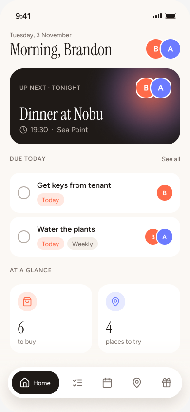
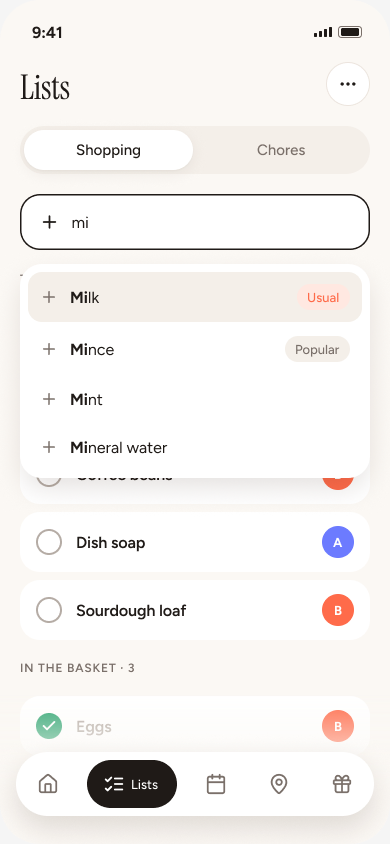
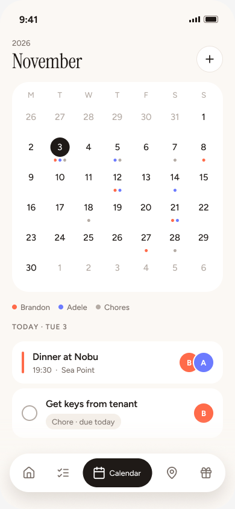
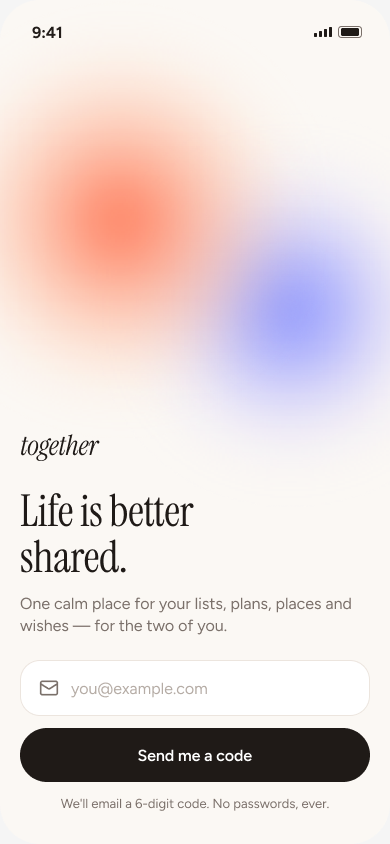
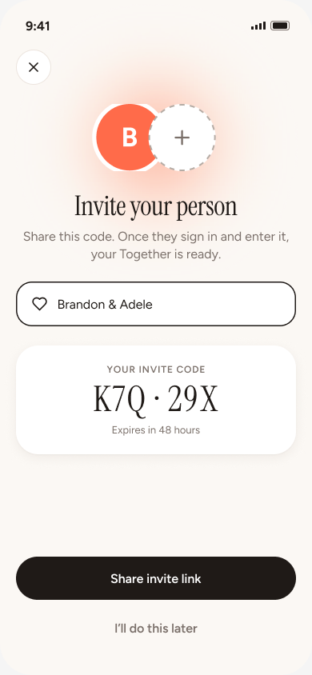
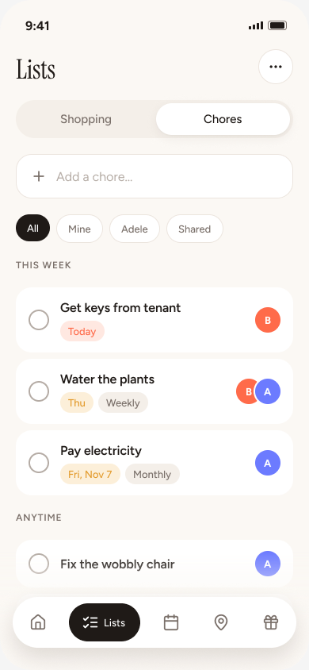
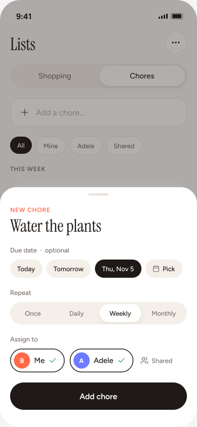
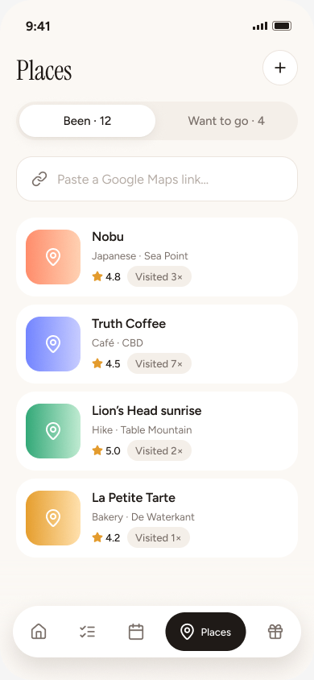
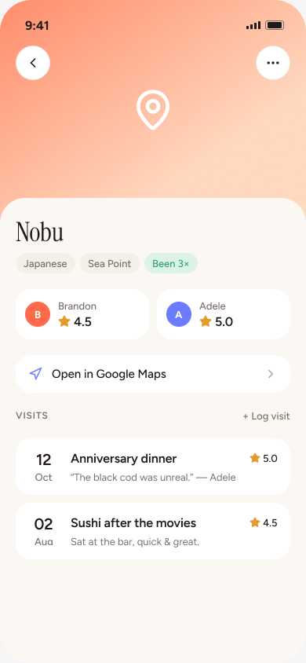
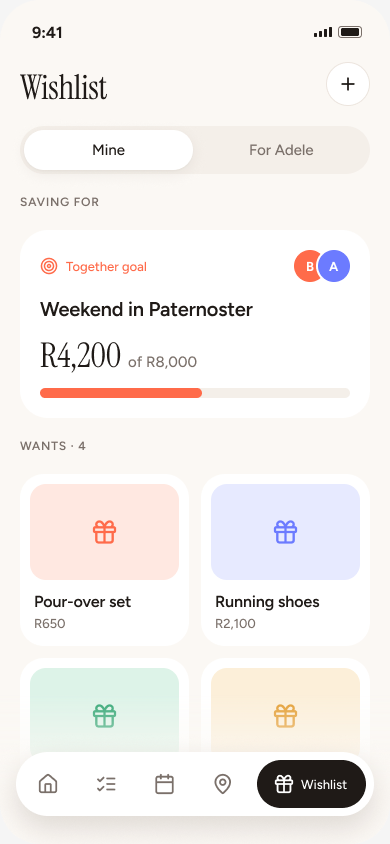

<div align="center">

# together

**Life is better shared.**

One calm place for your lists, plans, places and wishes, built for the two of you.

[Live app](https://together.openprocess.me) · [Figma file](https://www.figma.com/design/PpfaPk3jkZjwmsL4JeNzYJ/Together) · [Design system](https://together.openprocess.me/design-system)

<br />





</div>

---

## What it does

Together is a mobile-first app for couples (or any two people sharing a life). You sign in with a code sent to your
email, pair your accounts into a **Together**, and everything after that is shared.

| | |
|---|---|
|  | **Passwordless sign-in.** Enter your email and you get a 6-digit code through Supabase Auth OTP. The animated orb is a live Three.js shader that leans toward your finger. |
|  | **Pair up.** Create a Together and share its invite code, or join one with the code your partner sent. You get a name, two avatars, and one shared space. |
|  | **Home.** A greeting, what's up next, the chores due today, and a glance at the shopping list and places you want to try. |
|  | **Shopping list with autocomplete.** Suggestions come from what you usually buy. Ticked items drop into the basket, and one tap clears it. |
|  | **Chores.** Once-off or recurring (daily, weekly, monthly), with optional due dates and one or more assignees. You can filter by *Mine*, *theirs* or *Shared*. When you finish a recurring chore, it moves to its next date. |
|  | **Add a chore** in a draggable bottom sheet. Set who it's for, when it's due and how often it repeats. |
|  | **Shared calendar.** Events are coloured by person, and chores with due dates show up on the same grid and in the day's agenda. |
|  | **Places.** Paste a Google Maps link (or the text the Maps app shares) and it's matched on Google Places: the real name, its kind, and the suburb, city, province and country. Or just type a name. Each place goes under *Been* or *Want to go*, and the same Google place is never saved twice. |
|  | **Place detail.** Google's photo (with its credit) and rating, the address with today's hours, ratings from each of you, and a visit history with notes. |
|  | **Wishlist.** Goals you save towards, alone or together, plus the things you'd love. On your partner's list you can quietly claim a gift; they never see who claimed it. |

---

## Stack

| | |
|---|---|
| Framework | [Next.js 16](https://nextjs.org) (App Router, Turbopack, `proxy.ts`, typed routes) on React 19 |
| Styling | Tailwind CSS 4 (`@theme` tokens), `class-variance-authority`, `tailwind-merge` |
| Motion | [Motion](https://motion.dev) for springs, shared layouts and drag-to-dismiss sheets |
| 3D | three.js + @react-three/fiber: a simplex-noise shader orb, lazy-loaded with a CSS fallback and turned off for reduced motion |
| Auth & data | Supabase (`@supabase/ssr`) email OTP. An in-memory **stub backend** runs by default. |
| Places | [Google Places API (New)](https://developers.google.com/maps/documentation/places/web-service/op-overview), called only from the server. Optional. |
| Icons / inputs | lucide-react, input-otp |
| Tooling | TypeScript 6 (strict), ESLint 9 with import-boundary rules, Vitest, pnpm |
| Hosting | Vercel → `together.openprocess.me` |

---

## Getting started

```bash
pnpm install
```

```bash
cp .env.example .env.local
```

```bash
pnpm dev
```

Open <http://localhost:3000>. The app runs on the **stub backend** by default, so you don't need any Supabase keys:

- Any email works. **Any 6-digit code signs you in**, except `000000`, which fails so you can see the error state.
- You're signed in as **Brandon**, paired with **Adele**, with a few weeks of seed data relative to today.
- State lives in memory for as long as the dev server runs. Every backend call logs `[stub] …` to the terminal.
- Google Places is canned too: links to Nobu, Zeitz MOCAA or Woodlands Boulevard match those places, and any other
  link gets a made-up match, so adding places works offline.

### Scripts

| Command | What it does |
|---|---|
| `pnpm dev` | Dev server |
| `pnpm build` / `pnpm start` | Production build / serve |
| `pnpm lint` | ESLint, including the MVVM import boundaries. Zero warnings allowed. |
| `pnpm typecheck` | `next typegen` + `tsc --noEmit` |
| `pnpm test` | Vitest unit tests for the pure helpers in `lib/` |
| `pnpm test:db` | Loads `supabase/schemas` on PGlite and checks row-level security as different users |
| `pnpm run ci` | lint + typecheck + test + test:db |

### Environment

| Variable | Default | Purpose |
|---|---|---|
| `USE_STUB_DATABASE` | `true` | Server side: use the in-memory stub instead of Supabase |
| `NEXT_PUBLIC_USE_STUB_DATABASE` | `true` | Browser side: stub auth, and `proxy.ts` skips the session check |
| `NEXT_PUBLIC_SUPABASE_URL` | – | Your Supabase project URL |
| `NEXT_PUBLIC_SUPABASE_PUBLISHABLE_KEY` | – | Supabase publishable (anon) key |
| `SUPABASE_URL` | `NEXT_PUBLIC_SUPABASE_URL` | Where the **server** reaches Supabase, when that differs from the browser's address |
| `GOOGLE_MAPS_API_KEY` | – | Optional, server only. A key with the Places API (New) enabled, restricted to that API and the server's IP (a key restricted to websites is refused). Without it, places keep what the Maps link says. |

`.env.local` is gitignored. Never commit real keys.

---

## Architecture: MVVM

The app follows the same Model / View / ViewModel split as `inboxforge-ui`. The rule that matters most: **IO only
happens in view-models and server pages.** Components are pure UI, and ESLint enforces this.

```
lib/models/            Models: domain types (Member, Together, Chore, Place, WishItem…). No logic, no IO.
lib/<feature>/         Pure helpers that shape models for the UI (month grid, suggestions, Maps links, Google types). Tested.
lib/google/            Google Places API (New) client, server only, used by the Supabase backend
lib/backend/
├── interfaces/        The contract: ServerBackendService (data) + BrowserBackendService (auth)
├── services/stub/     In-memory stub with seed data
├── services/real/     Supabase implementations
├── server.ts          serverBackend: picks stub or real
└── browser.ts         browserBackend: picks stub or real
lib/actions/           Server actions ("use server"). The only way client code reaches serverBackend.

app/<route>/
├── page.tsx           Server Component: loads initial data through lib/actions, renders the View
├── view.tsx           Client Component (View): wires the view-model to a screen component
└── view-model.ts      Client hook (ViewModel): state + ALL IO (server actions, browserBackend, routing)

components/
├── ui/                The design system (tokens in app/globals.css, showcase at /design-system)
└── <feature>/         Screens: pure UI. Props in, callbacks out.
```

```
page.tsx (server) ──lib/actions──▶ serverBackend ──▶ stub | Supabase
   │ initial data
   ▼
view.tsx ──▶ useXViewModel() ──server actions / browserBackend / router──▶ IO
   │ props + callbacks
   ▼
components/<feature>/*-screen.tsx  (pure UI, no IO)
```

**Where IO is allowed.** `components/**` can't import `lib/actions`, `lib/backend`, `lib/supabase`, `next/navigation`
or `app/**`. When a component needs to do something, it takes a callback prop (`onDoneChange`, `onAdd`) and the
view-model provides it.

**Optimistic updates.** View-models update local state first, call the server action, then roll back and set an error
if it fails. Rows that were added optimistically keep their React key once saved, so they don't animate twice. For an
example, see `app/(app)/_lib/use-chores.ts`.

**Loading.** Every tab has a `loading.tsx` skeleton (`components/ui/skeleton.tsx`), so a tap shows the screen's
shape straight away while the server loads its data, and the tab bar's pill moves on tap.

**Stub or Supabase.** `services/real/server.ts` implements `ServerBackendService` on Supabase, and
`services/stub/server.ts` on seed data. `USE_STUB_DATABASE` picks one, and nothing above the backend layer changes.

### Routes

| Route | Screen |
|---|---|
| `/sign-in`, `/verify` | Email → 6-digit OTP |
| `/onboarding/together`, `/onboarding/invite` | Create or join a Together, then share the invite code |
| `/home` | Today at a glance |
| `/lists` (`?tab=chores`) | Shopping and Chores |
| `/calendar` | Month grid + day agenda |
| `/places` (`?tab=want`), `/places/[id]` | Places and place detail |
| `/wishlist` | Goals, your wishes, and your partner's list |
| `/design-system` | Every token and component (public) |

### Database

The Supabase schema is declarative, in `supabase/schemas/`. It has `tables/` and versioned `functions_v1/`
folders, and migrations are generated from it with `just create-migration <name>`. Its main properties:

- Every shared table belongs to a Together.
- Row-level security keeps each couple's data to themselves.
- Composite foreign keys stop rows from crossing between Togethers.
- Wish claims live in their own table, so the database hides them from the wish's owner.
- Places from Google keep only what Google's terms allow: the place id, and coordinates for 30 days. The rating,
  hours, photo and street are fetched fresh each time a place is shown.

The ER diagram, the reasoning and the setup steps are in **[docs/database.md](docs/database.md)**.

---

## Design system

The design lives in Figma: **[Together on Figma](https://www.figma.com/design/PpfaPk3jkZjwmsL4JeNzYJ/Together)**.
The *📱 Screens* page holds every screen above, and *🧩 Foundations* holds the tokens and components. The code mirrors it:

- **Tokens** are in `app/globals.css` (`@theme`):
  - **Colours.** Warm paper `#FBF8F4`, ink `#1F1A17`, **coral `#FF6B4A` for Brandon** and **periwinkle `#6C7BFF` for Adele**, plus success and warning. Each colour comes with `-soft` and `-ink` shades.
  - **Type.** Instrument Serif for display, Figtree for UI, as `text-display-xl … text-overline` utilities.
  - **Radii and shadows.**
- **Components** in `components/ui/` match the Figma components one to one:
  - Button, IconButton, Chip/PillButton, Avatar/AvatarStack, Checkbox, Segmented, TextField, OtpInput, TaskRow, TabBar, Sheet, Progress, Thumb/Rating, Card/SectionHeader/EmptyState, Orb.
- **`/design-system`** renders all of them, live, with every variant.

Motion is meant to be calm, not busy:

- Spring-based reveals, a shared-layout pill on tabs and segments, and a drawn tick with a strike-through when you complete a task.
- Sheets you can drag to dismiss.
- Everything respects `prefers-reduced-motion`.

---

## Deploying

Together can be deployed on Vercel, or self-hosted with Docker next to a self-hosted Supabase (Coolify). For the
self-hosted setup, see **[docs/deploy.md](docs/deploy.md)**: the `Dockerfile`, the `docker-compose.yml` with the full
Supabase stack, the variables, and the CI workflows that test-build the image.

On Vercel, the project deploys from this repository's `main` branch.

1. Import the repo in Vercel. The framework is detected automatically.
2. Set `USE_STUB_DATABASE=true` and `NEXT_PUBLIC_USE_STUB_DATABASE=true` to run the demo, or set the Supabase variables
   and set both flags to `false`.
3. Add the domain `together.openprocess.me` and point a `CNAME` for `together` to `cname.vercel-dns.com`.

For Supabase auth:

- Add `https://together.openprocess.me/**` to the redirect URLs.
- Make the email template send `{{ .Token }}` (the OTP code) rather than a magic link.

---

## Roadmap

- [x] Supabase schema and row-level security ([docs/database.md](docs/database.md))
- [x] The real `ServerBackendService` on top of it
- [x] Places matched on Google Places from a Maps link
- [ ] Logging visits and ratings from place detail
- [ ] Adding places by searching Google (autocomplete), by hand, and editing them
- [ ] Filtering and grouping places by city, province and country
- [ ] Members, invites and more than one Together per person
- [ ] Adding calendar events and wishes from the app
- [ ] Realtime sync between partners
- [ ] PWA install + push reminders for due chores
