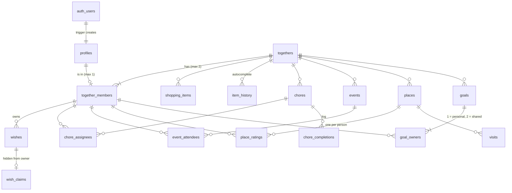

# Database

Together runs on Supabase Postgres. The schema is **declarative**: `supabase/schemas` describes the database as it
should be, and migrations are generated from it. [`supabase/tests/schema.test.mjs`](../supabase/tests/schema.test.mjs)
checks it. Run the tests with `pnpm test:db`; they use PGlite, so no Docker is needed.

## Layout

```
supabase/schemas/
├── types/enums.sql            enums shared by the tables
├── tables/NN_<table>.sql      one table each: columns, indexes, RLS and its policies, in dependency order
├── internal/                  helpers other SQL calls; the app never does, so they aren't versioned
├── functions_v1/v1_<name>.sql the RPCs the app calls, one per file, named with their version
├── triggers/<name>.sql        trigger function + the trigger
└── realtime.sql               tables published to Supabase Realtime
```

`schema_paths` in `supabase/config.toml` sets the load order: types, tables, internal, functions, triggers, realtime.

### Changing the schema

1. Edit the files in `supabase/schemas`.
2. Run `just create-migration <name>`. It runs `supabase db schema declarative sync --no-apply`, which diffs the
   schemas against the existing migrations and writes `supabase/migrations/<timestamp>_<name>.sql`. Your local database
   isn't touched.
3. Read the generated file. Run `pnpm test:db`.

**Never write or edit a migration by hand.** If the generated SQL is wrong, fix the schema files and generate again.

### Versioning functions

App-facing functions carry their version in both the folder and the name: `functions_v1/v1_join_together.sql`
defines `public.v1_join_together`. This is the same convention as inboxforge.

To change a function's arguments or what it returns:

1. Add `functions_v2/v2_<name>.sql`, and move the app to `v2_`.
2. Leave `v1_` in place until no deployed client calls it any more.

Old and new frontends can then run against the same database during a deploy. A fix that keeps the signature
and behaviour the same can edit the existing version in place.

## Shape

Everything shared hangs off a **together**, which holds two people. Every shared table carries `together_id`.



| Table | Holds | Maps to |
|---|---|---|
| `profiles` | Name, one per auth user | `Member` (`initial` is derived) |
| `togethers` | Name, invite code, time zone | `Together` |
| `together_members` | Who's in it, and their colour (`accent` / `partner`) | `Together.members`, `Member.tone` |
| `shopping_items` | The list; `done_at` set = in the basket | `ShoppingItem` |
| `item_history` | Every name ever added, with counts | `CatalogEntry` via `v1_item_catalog()` |
| `chores`, `chore_assignees` | Chores and who they're for | `Chore` |
| `chore_completions` | Who ticked what, when | (history; not in the UI yet) |
| `events`, `event_attendees` | Calendar | `CalendarEvent` |
| `places`, `place_ratings`, `visits` | Places, each person's rating, visit log | `Place`, `Visit` |
| `wishes`, `wish_claims` | Wishes and who's secretly buying them | `WishItem` |
| `goals`, `goal_owners` | Savings goals | `Goal` |

Money is stored in cents (`price_cents`, `saved_cents`, `target_cents`). The models use whole rands, so the
Supabase service divides by 100.

## Decisions

**Two people, one Together each.** `together_members` has `unique (profile_id)`, so each person is in one Together.
It also has `unique (together_id, tone)`, which allows two people per Together, each with their own colour.
`getTogether()` returns a single Together, and that's what these constraints enforce. Allowing more people later
means relaxing these two constraints and adding more tones.

**Integrity across Togethers.** Child tables repeat `together_id` and use composite foreign keys:

- `(chore_id, together_id) → chores`
- `(together_id, profile_id) → together_members`

So the database itself rejects assigning a chore to someone outside the Together, without relying on a policy. When
someone leaves, their assignments, ratings and wishes cascade away, and the shared lists stay.

**Row-level security.** Every table has RLS on. The base rule is
`together_id = (select my_together_id())`. `my_together_id()` is `security definer`, which avoids policies recursing
into `together_members`. The `(select …)` wrapper makes Postgres evaluate it once per query instead of once per row.
Stricter rules sit on top:

- Shopping items can only be added as yourself (a restrictive policy).
- Ratings: you set only your own.
- Wishes: only the owner adds, edits or removes them.
- **Wish claims are a separate table, so RLS can hide them from the wish's owner.** Gifts stay a surprise at the
  database level, not just in the UI. Its primary key is `wish_id`, which allows one claim per wish.

**Writes that need more than RLS go through functions** (`supabase.rpc`):

| Function | Does |
|---|---|
| `v1_create_together(name)` | Makes the Together with a fresh 6-character code (no 0/O/1/I), and adds you as `accent` |
| `v1_join_together(code)` | Normalises the code (case, spaces, dashes), checks the Together isn't full, adds you as `partner` |
| `v1_set_chore_done(id, done)` | Once-off: sets `done_at`. Recurring: logs the completion and moves `due` to the next date after today in the Together's time zone. Monthly keeps the day of the month (31 Jan → 28 Feb → 31 Mar). |
| `v1_item_catalog()` | Your history plus "popular" names. A name counts as popular only when at least 3 Togethers have added it, so one couple's list never leaks. |

`togethers` has no insert policy, so you can only create or join one through these functions.

**Places from Google.** Google's terms only let us store a place's id for good, and its coordinates for 30 days. So a
place saved from a Maps link keeps `google_place_id` (one row per Google place per Together), `lat`/`lng` with
`location_fetched_at` (refreshed when the place is opened and the coordinates are over 30 days old), and our own
`area`/`city`/`province`/`country` labels, prefilled from Google for filtering and grouping. The street, rating, hours
and photo are fetched fresh when the place is shown (`lib/google/places.ts`). `street` is only filled for places
added by hand.

**Triggers.**

- A profile is created for every new auth user. The name comes from sign-up metadata, or the part of the email before the `@`.
- Adding a shopping item bumps `item_history`.
- Logging a visit flips the place to `been`.

**Local ports.** Together's local Supabase stack uses ports 54420–54429, so it can run alongside inboxforge's
(543xx).

**Realtime.** The shared tables are added to `supabase_realtime`, so each person sees the other's changes live.
`wish_claims` is left out on purpose. Realtime applies RLS anyway, but claims don't need to be live.

## Applying it

```bash
just db-link <your-project-ref>
```

```bash
just db-push
```

Then:

1. In the Supabase dashboard, open Auth → Email templates and make the template send `{{ .Token }}`, so users get a
   6-digit code instead of a magic link.
2. Set `USE_STUB_DATABASE=false` and `NEXT_PUBLIC_USE_STUB_DATABASE=false`.
3. Generate types with `just gen-types`. This needs the local stack (`just db-start`).
4. Implement `lib/backend/services/real/server.ts` against these tables.
